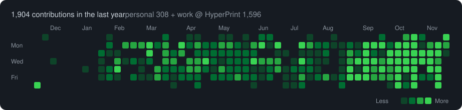

Card layout inspired by <a href="https://github.com/Andrew6rant/Andrew6rant">Andrew Grant's profile README</a>. The portrait, animation, stats and combined contribution graph (personal + <a href="https://github.com/khushbawalhyperprint">work account</a>) are generated by <a href="scripts">scripts/</a> and refreshed daily by a GitHub Action.
